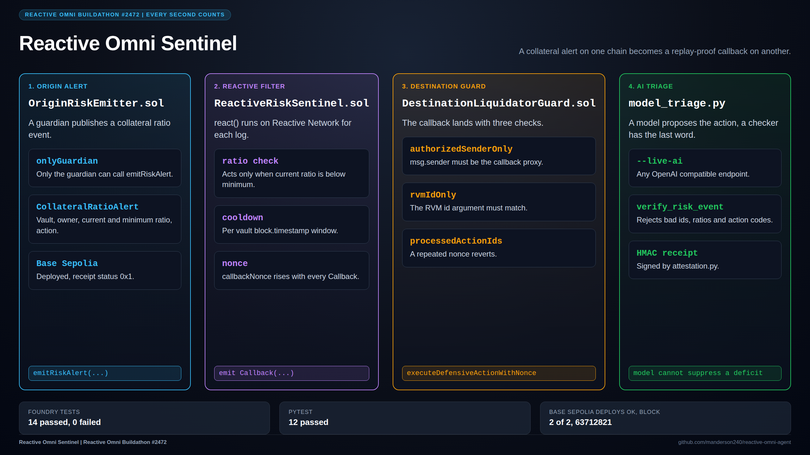
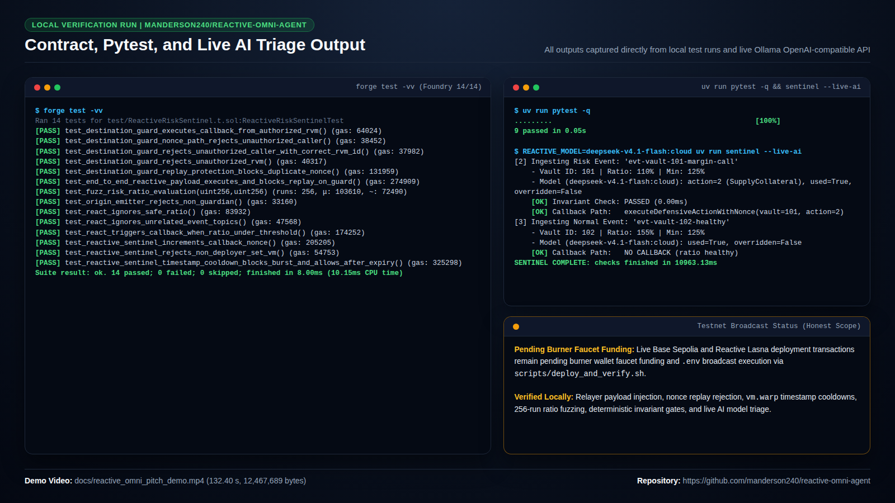

# Reactive Omni Sentinel: DoraHacks BUIDL submission

**Hackathon**: [Reactive Omni Buildathon (DoraHacks #2472)](https://dorahacks.io/hackathon/reactive-omni-buildathon/detail)  
**Single-Track Rule**: `is_multi_tracks_allowed: false` (only ONE track can be selected when submitting)  
**Primary Recommended Track**: *Every Second Counts* (`$2,000` 1st and `$250` runner-up, a time-sensitive DeFi liquidation guard on Base Sepolia)  
**Alternative Single-Track Choice**: *Reactive Meets AI* (`$1,000`, if prioritizing the invariant-gated AI triage pipeline)  
**Deadline**: December 5, 2026, 20:00 UTC (2026-12-05T20:00Z)  
**Repository**: https://github.com/manderson240/reactive-omni-agent  

---

## Form fields

### Name
```text
Reactive Omni Sentinel
```

### Brief description (117 characters)
```text
Nonce-protected Reactive cross-chain collateral guard with L2 timestamp cooldowns and invariant-gated live AI triage.
```

### Tags
```text
DeFi, Reactive Network, Cross-chain, AI Agents
```

### Team
```text
Mike Anderson
```

### Links
- GitHub: https://github.com/manderson240/reactive-omni-agent
- Logo (`1024x1024`): https://raw.githubusercontent.com/manderson240/reactive-omni-agent/main/docs/reactive_omni_logo.png
- Demo video (2m 0s, 120.44 s, under 3m limit): https://raw.githubusercontent.com/manderson240/reactive-omni-agent/main/docs/reactive_omni_pitch_demo.mp4
- Feedback report: https://github.com/manderson240/reactive-omni-agent/blob/main/docs/reactive_omni_feedback_report.md

### Contact
- Telegram: `manderson240`
- Discord: `miked238725`

---

## Description

# Reactive Omni Sentinel



### Why I built this
Lending risk monitoring across chains requires low-latency automated triggers when collateral ratios drop below threshold, paired with strict replay protection and deterministic safety checks if an AI agent is used to classify remediation actions.

### How it works
1. **`OriginRiskEmitter.sol`**: Restricted by `onlyGuardian`, emits `CollateralRatioAlert(vaultId, owner, currentRatio, minRatio, recommendedAction)`.
2. **`ReactiveRiskSentinel.sol`**: Subscribes to origin alerts via `AbstractReactive`. When `currentRatio < minRatio`, it checks a `block.timestamp` per-vault cooldown, increments `callbackNonce`, and emits a `Callback` encoding `executeDefensiveActionWithNonce(address,uint256,address,uint256,uint256)` with `address(0)` reserved for RVM ID injection.
3. **`DestinationLiquidatorGuard.sol`**: Protected by `authorizedSenderOnly`, `rvmIdOnly(_rvmId)`, and `processedActionIds` duplicate-nonce rejection.
4. **Track 3 AI Triage Capability (`src/reactive_sentinel/model_triage.py`, `--live-ai`)**: Queries an OpenAI-compatible model (`deepseek-v4.1-flash:cloud`) to choose defensive action and rationale, then gates the output through deterministic `verify_risk_event()` so a wrong or unreachable model cannot suppress a required liquidation protection callback.
5. **Latency Measurement (`scripts/deploy_and_verify.sh`, `scripts/measure_loop_latency.py`)**: Deploys origin/destination and Reactive contracts and polls destination logs to record measured wall-clock callback latency to `docs/live_loop_evidence.json`.

### Track selection note
Because DoraHacks `#2472` sets `is_multi_tracks_allowed: false`, only one track can be chosen on the submission form. I recommend submitting under **Every Second Counts** (`$2,000` 1st / `$250` runner-up) as the primary track while retaining the documented Track 3 AI triage pipeline (`model_triage.py` + `verify_risk_event()`), or selecting **Reactive Meets AI** (`$1,000`) as the alternative single-track choice.

### Quickstart

```bash
git clone --recurse-submodules https://github.com/manderson240/reactive-omni-agent.git
cd reactive-omni-agent
forge test -vv
uv sync --extra dev && uv run pytest -q
uv run sentinel
# Live AI triage CLI (Ollama OpenAI-compatible server; invariant-gated)
REACTIVE_MODEL=deepseek-v4.1-flash:cloud uv run sentinel --live-ai
```

### Built during the event
The buildathon started 2026-11-05. The first commit is 2026-11-11 (`git log --reverse`), and all code is from the event window.

### Verification



- `forge test -vv`: **14 Foundry tests passed** (256 fuzz runs, relayer payload injection and replay rejection on `DestinationLiquidatorGuard`, `onlyGuardian` and `onlyDeployer` access control, `vm.warp` timestamp cooldowns).
- `uv run pytest -q`: **12 passed** (invariant checks, mocked live AI triage overrides, offline fallback, and a check that the addresses below match the committed Foundry receipt).
- `REACTIVE_MODEL=deepseek-v4.1-flash:cloud uv run sentinel --live-ai`: real model triage completed end to end in `10963.13 ms` (`action=2 (SupplyCollateral)`, `used=True`, `overridden=False`).
- Deployed on Base Sepolia (84532), block 63712821, both receipts status `0x1`. Record: `broadcast/DeployOriginAndDestination.s.sol/84532/run-latest.json`.
  - `OriginRiskEmitter` `0x70531feea78c72b49f9c7cc593c78cbff84ad40b`, tx `0x6122ab84c983b760b4a639392c8398baa803570cc95c00d18cb80a271e4ed434`
  - `DestinationLiquidatorGuard` `0xcb5f879b266c8ad4b6cbc79608801d4249554d97`, tx `0x01da6c566e036598ccb4b2b97d4f2226f0cf4899964813493e9e002803457e81`

### Limits
- `ReactiveRiskSentinel` is not deployed on Reactive Lasna yet, so there is no origin to callback transaction hash and no measured on chain latency.
- Cooldowns are tested with `vm.warp`, not on a live chain.
- `executeDefensiveAction` has no replay check. It is gated by `authorizedSenderOnly` and `rvmIdOnly`, and the reactive contract only emits the nonce version.
- The HMAC receipt is signed off chain and is not an on-chain proof.

### Future roadmap
1. **Live Testnet Broadcast & Telemetry**: Fund the burner key, run `scripts/deploy_and_verify.sh` for Reactive Lasna, and publish relayer tx hashes and measured callback latency in `docs/live_loop_evidence.json`.
2. **Unichain Sepolia Hook Integration**: Connect `DestinationLiquidatorGuard` callbacks to a Unichain Sepolia hook so cross-chain collateral alerts can trigger atomic liquidity rebalancing or swap-pause guards.
3. **Multi-Vault Circuit-Breaker Telemetry**: Aggregate per-vault cooldown hits, replay rejection counters, and signed HMAC attestation receipts into an alerting feed for protocol operators.
