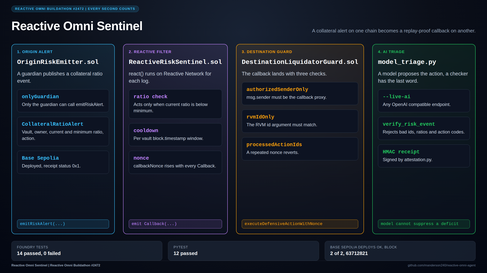
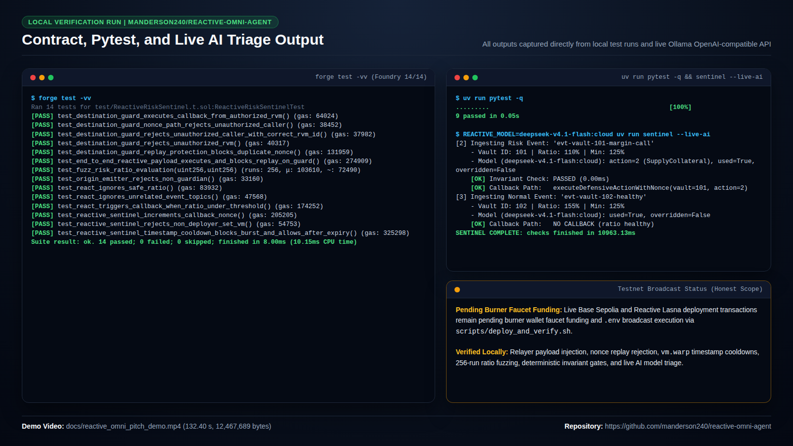

# Reactive Sentinel

A cross-chain risk guard built on Reactive Network for the [Reactive Omni Buildathon on DoraHacks (#2472)](https://dorahacks.io/hackathon/reactive-omni-buildathon/detail) (recommended single track: *Every Second Counts*, with full *Reactive Meets AI* Track 3 triage capability).



[Demo video (2m 0s)](https://raw.githubusercontent.com/manderson240/reactive-omni-agent/main/docs/reactive_omni_pitch_demo.mp4)

An origin contract (`OriginRiskEmitter`, restricted with `onlyGuardian`) emits `CollateralRatioAlert`. A reactive contract (`ReactiveRiskSentinel`) subscribes to that event, checks `currentRatio < minRatio`, enforces per-vault `block.timestamp` cooldowns, increments a monotonic `callbackNonce`, and emits a Reactive `Callback` calling `executeDefensiveActionWithNonce` on `DestinationLiquidatorGuard` (`authorizedSenderOnly` + `rvmIdOnly` + `processedActionIds` replay protection). Off-chain, `reactive_sentinel` runs AI triage (`--live-ai`) gated by a deterministic invariant checker (`verify_risk_event`) and turnkey cross-chain deployment + latency measurement scripts (`scripts/deploy_and_verify.sh`, `scripts/measure_loop_latency.py`).

---

## Quickstart

```bash
git clone --recurse-submodules https://github.com/manderson240/reactive-omni-agent.git
cd reactive-omni-agent

# Contracts (needs Foundry)
forge test -vv

# Python tests (invariant checks + mocked live AI triage)
uv sync --extra dev
uv run pytest -q

# Deterministic CLI demo
uv run sentinel

# Live AI triage CLI (Ollama OpenAI-compatible server; invariant-gated)
REACTIVE_MODEL=deepseek-v4.1-flash:cloud uv run sentinel --live-ai
```

### Verified test and live AI CLI outputs from my run



```text
$ forge test -vv
Suite test/ReactiveRiskSentinel.t.sol:ReactiveRiskSentinelTest
[PASS] test_destination_guard_executes_callback_from_authorized_rvm() (gas: 64024)
[PASS] test_destination_guard_nonce_path_rejects_unauthorized_caller() (gas: 38452)
[PASS] test_destination_guard_rejects_unauthorized_caller_with_correct_rvm_id() (gas: 37982)
[PASS] test_destination_guard_rejects_unauthorized_rvm() (gas: 40317)
[PASS] test_destination_guard_replay_protection_blocks_duplicate_nonce() (gas: 131959)
[PASS] test_end_to_end_reactive_payload_executes_and_blocks_replay_on_guard() (gas: 274909)
[PASS] test_fuzz_risk_ratio_evaluation(uint256,uint256) (runs: 256, μ: 103610, ~: 72490)
[PASS] test_origin_emitter_rejects_non_guardian() (gas: 33160)
[PASS] test_react_ignores_safe_ratio() (gas: 83932)
[PASS] test_react_ignores_unrelated_event_topics() (gas: 47568)
[PASS] test_react_triggers_callback_when_ratio_under_threshold() (gas: 174252)
[PASS] test_reactive_sentinel_increments_callback_nonce() (gas: 205205)
[PASS] test_reactive_sentinel_rejects_non_deployer_set_vm() (gas: 54753)
[PASS] test_reactive_sentinel_timestamp_cooldown_blocks_burst_and_allows_after_expiry() (gas: 325298)
Suite result: ok. 14 passed, 0 failed, 0 skipped

$ uv run pytest -q
12 passed

$ REACTIVE_MODEL=deepseek-v4.1-flash:cloud uv run sentinel --live-ai
[2] Ingesting Risk Event: 'evt-vault-101-margin-call'
    - Vault ID: 101 | Collateral Ratio: 110% | Min Ratio: 125%
    - Invariant Status: DEFICIT DETECTED (Ratio < Threshold)
    - Model (deepseek-v4.1-flash:cloud): action=2 (SupplyCollateral), used=True, overridden=False
    - Rationale: The vault ratio is below the minimum, so supplying collateral is needed to restore it.
    [OK] Invariant Check:   PASSED (0.00ms)
    [OK] Callback Path:     executeDefensiveActionWithNonce(vault=101, action=2)
    [OK] Attestation Sig:   cb9aec2e5fcbba35323eda06...
SENTINEL COMPLETE: checks finished in 10963.13ms
```

---

## How it works

### Contracts

1. [`src/OriginRiskEmitter.sol`](src/OriginRiskEmitter.sol): `onlyGuardian` `emitRiskAlert(vaultId, owner, currentRatio, minRatio, recommendedAction)` emits `CollateralRatioAlert`.
2. [`src/ReactiveRiskSentinel.sol`](src/ReactiveRiskSentinel.sol): extends `AbstractReactive`. Constructor binds `deployer` access control and subscribes to `CollateralRatioAlert` when not in ReactVM. `react(LogRecord)` enforces `block.timestamp` per-vault cooldowns (`cooldownSeconds`), increments `callbackNonce`, and emits a `Callback` encoding `executeDefensiveActionWithNonce(address,uint256,address,uint256,uint256)` so replay protection runs on the real callback path.
3. [`src/DestinationLiquidatorGuard.sol`](src/DestinationLiquidatorGuard.sol): extends `AbstractCallback`. Guards `executeDefensiveActionWithNonce` with `authorizedSenderOnly`, `rvmIdOnly(_rvmId)`, and `processedActionIds[actionId]`.

### Python package (`src/reactive_sentinel/`)

1. [`verifier.py`](src/reactive_sentinel/verifier.py): `verify_risk_event()` enforces positive IDs/ratios, `action_code in {1, 2, 3}`, and `current_ratio < min_ratio` in <0.1ms.
2. [`model_triage.py`](src/reactive_sentinel/model_triage.py): `triage_risk_event_with_model()` queries any OpenAI-compatible `/v1/chat/completions` endpoint (`REACTIVE_MODEL` / `REACTIVE_BASE_URL`) to classify remediation action (RepayDebt vs SupplyCollateral) and rationale, then gates the response through `verify_risk_event()` so a hallucinated or malformed model output cannot suppress a deficit callback.
3. [`agent.py`](src/reactive_sentinel/agent.py) and [`attestation.py`](src/reactive_sentinel/attestation.py): orchestrate deterministic and live-AI paths and sign HMAC-SHA256 receipts.
4. [`scripts/measure_loop_latency.py`](scripts/measure_loop_latency.py) and [`scripts/deploy_and_verify.sh`](scripts/deploy_and_verify.sh): automate deployment to origin/destination and Reactive Lasna, broadcast a live risk alert, poll `RebalanceExecuted`, and record end-to-end latency to `docs/live_loop_evidence.json`.

---

## Deployed on Base Sepolia (84532)

Foundry deployed the origin and destination contracts. Both receipts have status `0x1` at block 63712821. The record is [`broadcast/DeployOriginAndDestination.s.sol/84532/run-latest.json`](broadcast/DeployOriginAndDestination.s.sol/84532/run-latest.json), and `tests/test_receipts.py` checks that this section matches it.

| Contract | Address | Deploy tx |
|---|---|---|
| `OriginRiskEmitter` | [`0x70531feea78c72b49f9c7cc593c78cbff84ad40b`](https://sepolia.basescan.org/address/0x70531feea78c72b49f9c7cc593c78cbff84ad40b) | `0x6122ab84c983b760b4a639392c8398baa803570cc95c00d18cb80a271e4ed434` |
| `DestinationLiquidatorGuard` | [`0xcb5f879b266c8ad4b6cbc79608801d4249554d97`](https://sepolia.basescan.org/address/0xcb5f879b266c8ad4b6cbc79608801d4249554d97) | `0x01da6c566e036598ccb4b2b97d4f2226f0cf4899964813493e9e002803457e81` |

The destination guard trusts the verified Base Sepolia callback proxy from the [Reactive origins and destinations page](https://dev.reactive.network/origins-and-destinations). To deploy the Reactive side and measure the loop, fund a burner key with lREACT, fill `.env` from `.env.example`, and run:

```bash
bash scripts/deploy_and_verify.sh
```

---

## Tests

```bash
~/.foundry/bin/forge test      # 14 Foundry tests, 256 fuzz runs
uv run pytest -q               # 12 passed
```

Foundry covers the reactive filter, cooldowns, nonces, access control and the guard replay block. Pytest covers the invariant checker, the model gate with a mocked endpoint, attestation signing and the receipt check above.

---

## Limits

- `ReactiveRiskSentinel` is not deployed on Reactive Lasna yet. The key was not funded with lREACT, so there is no origin to callback transaction hash. `docs/live_loop_evidence.json` does not exist for that reason.
- Cooldown behavior is tested with `vm.warp`, not measured on a live chain.
- `executeDefensiveAction` (no nonce) is still callable by the proxy. It is gated by `authorizedSenderOnly` and `rvmIdOnly`, but has no replay check. The reactive contract only emits the nonce version.
- The HMAC receipt is a shared secret signature made off chain. It is not an on-chain proof.
- Live AI triage needs an OpenAI compatible endpoint. If it fails, the deterministic result is used.

---

## Future roadmap

1. **Reactive Lasna deploy**: Fund the burner key, run `scripts/deploy_and_verify.sh`, and record the relayer tx hashes and measured latency in `docs/live_loop_evidence.json`.
2. **Unichain Sepolia Hook Integration**: Wire `DestinationLiquidatorGuard` callbacks into a Unichain Sepolia hook for automated pool-level protective actions when collateral ratios breach thresholds.
3. **Multi-Vault Circuit-Breaker Telemetry**: Export per-vault cooldown triggers, replay rejection events, and signed HMAC attestation receipts into an operator telemetry stream.

---

## Hackathon deliverables

- Logo (`1024x1024`): [`docs/reactive_omni_logo.png`](docs/reactive_omni_logo.png)
- Architecture diagram (`2560x1440`): [`docs/architecture_diagram.png`](docs/architecture_diagram.png)
- Verification output screenshot (`1600x900`): [`docs/verification_screenshot.png`](docs/verification_screenshot.png)
- Feedback report: [`docs/reactive_omni_feedback_report.md`](docs/reactive_omni_feedback_report.md)
- Pitch walkthrough video (`120.44 s` (2m 0s), `2560x1440` H.264/AAC, under the 3 minute limit): [`docs/reactive_omni_pitch_demo.mp4`](https://raw.githubusercontent.com/manderson240/reactive-omni-agent/main/docs/reactive_omni_pitch_demo.mp4)
- Built during the event: the buildathon started 2026-11-05 and the first commit is 2026-11-11 (`git log --reverse`). All code is from that window.
- Submission form text: [`BUIDL_SUBMISSION.md`](BUIDL_SUBMISSION.md)

## License

MIT
