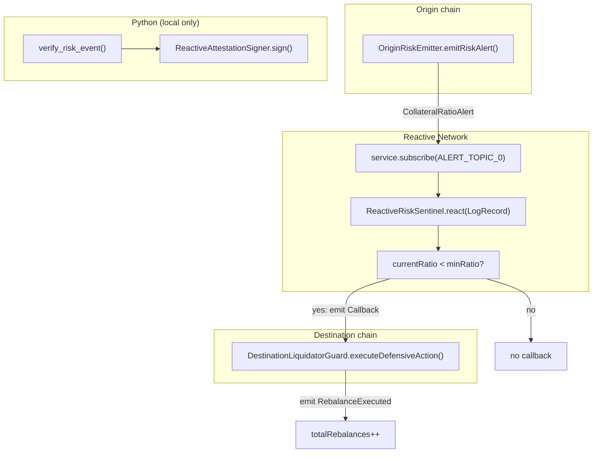
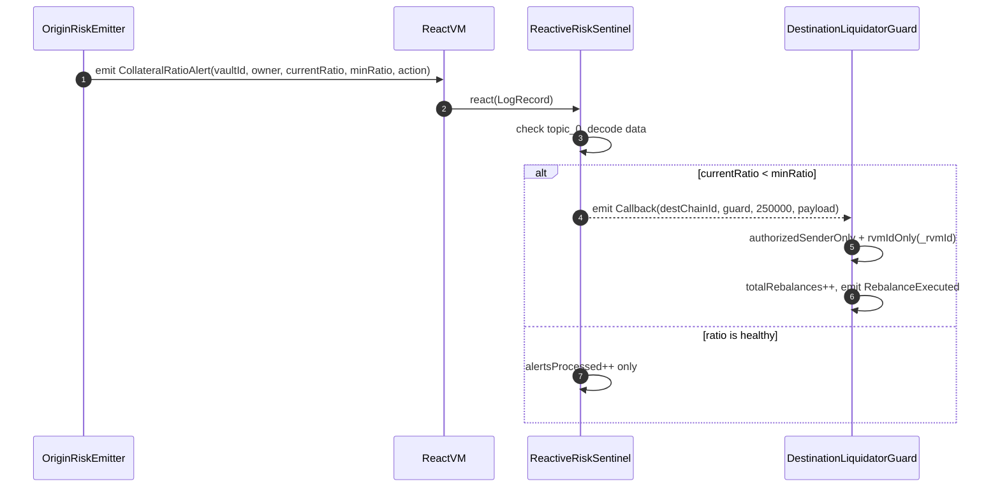

# Reactive Sentinel

A small cross-chain risk guard I built on Reactive Network for the [Reactive Omni Buildathon on DoraHacks](https://dorahacks.io/hackathon/reactive-omni-buildathon/detail) (Track 1 "Every Second Counts" and Track 3 "Reactive Meets AI").

An origin contract emits a `CollateralRatioAlert` event. A reactive contract subscribes to that event, checks `currentRatio < minRatio`, and if the vault is under its threshold it emits a Reactive `Callback` that calls a guard contract on the destination chain. A separate Python package runs the same threshold check off-chain, validates the action code, and signs an HMAC-SHA256 receipt for each event.

Everything here runs locally: Foundry tests for the contracts and a Python demo CLI. No deployment is recorded in this repo yet (see [Limits](#limits)).

---

## Quickstart

```bash
git clone --recurse-submodules https://github.com/manderson240/reactive-omni-agent.git
cd reactive-omni-agent

# Contracts (needs Foundry)
forge test

# Python package
uv sync --extra dev
uv run pytest
uv run sentinel
```

### Test output from my run

```text
$ forge test
Ran 7 tests for test/ReactiveRiskSentinel.t.sol:ReactiveRiskSentinelTest
[PASS] test_destination_guard_executes_callback_from_authorized_rvm() (gas: 61611)
[PASS] test_destination_guard_rejects_unauthorized_rvm() (gas: 37884)
[PASS] test_destination_guard_replay_protection_blocks_duplicate_nonce() (gas: 126693)
[PASS] test_fuzz_risk_ratio_evaluation(uint256,uint256) (runs: 256, μ: 82035, ~: 72140)
[PASS] test_react_ignores_safe_ratio() (gas: 75894)
[PASS] test_react_ignores_unrelated_event_topics() (gas: 47633)
[PASS] test_react_triggers_callback_when_ratio_under_threshold() (gas: 118765)
Suite result: ok. 7 passed; 0 failed; 0 skipped; finished in 7.11ms (5.79ms CPU time)

$ uv run pytest -q
......                                                                   [100%]
6 passed in 0.03s
```

One of the seven Foundry tests is a fuzz test (256 runs). Timings are from my machine.

### Demo output (`uv run sentinel`, chain ID variables unset)

```text
====================================================================
  REACTIVE SENTINEL (Reactive Omni Network)
  DoraHacks Buildathon: Autonomous Cross-Chain Invariant Guardian
====================================================================

[1] Initialized Reactive Sentinel Agent: 'sentinel-node-01'
    - Origin Network:      Chain ID ${ORIGIN_CHAIN_ID}
    - Reactive Network:    Chain ID ${REACTIVE_CHAIN_ID}
    - Destination Network: Chain ID ${DESTINATION_CHAIN_ID}

[2] Ingesting Risk Event: 'evt-vault-101-margin-call'
    - Vault ID: 101 | Collateral Ratio: 110% | Min Ratio: 125%
    - Invariant Status: DEFICIT DETECTED (Ratio < Threshold)
    [OK] Invariant Check:   PASSED (valid event structure in 0.00ms)
    [OK] Action Triggered:  CALLBACK REQUIRED -> executeDefensiveAction(vault=101, action=1)
    [OK] Attestation Sig:   8a5fc17b503d75aba640e7f0...
    [OK] Reactive Status:   EXECUTED ON LASNA

[3] Ingesting Normal Event: 'evt-vault-102-healthy'
    - Vault ID: 102 | Collateral Ratio: 155% | Min Ratio: 125%
    - Invariant Status: HEALTHY (Ratio >= Threshold)
    [OK] Invariant Check:   PASSED (valid event structure in 0.00ms)
    [OK] Action Triggered:  NO CALLBACK (compute and gas conserved)
    [OK] Attestation Sig:   892d0df1d7a4df9c07afb507...
    [OK] Reactive Status:   PASSED (IDLE)

====================================================================
  SENTINEL COMPLETE: ALL INVARIANTS VERIFIED in 0.08ms
  Status: READY FOR REACTIVE LASNA TESTNET
====================================================================
```

The signatures change on every run because the receipt includes a nanosecond timestamp. The lines "EXECUTED ON LASNA" and "READY FOR REACTIVE LASNA TESTNET" are fixed strings in [`cli.py`](src/reactive_sentinel/cli.py). The demo does not connect to any network; it only runs the Python check and signer on two hardcoded events.

---

## How it works

### Contracts

1. [`src/OriginRiskEmitter.sol`](src/OriginRiskEmitter.sol): `emitRiskAlert(vaultId, owner, currentRatio, minRatio, recommendedAction)` emits `CollateralRatioAlert`. `vaultId` and `owner` are indexed; the ratios (basis points) and action code go in the data field. It does not hold a vault; it is a stand-in that lets me emit test alerts.
2. [`src/ReactiveRiskSentinel.sol`](src/ReactiveRiskSentinel.sol): extends `AbstractReactive` from `reactive-lib`. The constructor calls `service.subscribe(originChainId, originContract, ALERT_TOPIC_0, ...)` when it is not running inside a ReactVM. `react(LogRecord)` (marked `vmOnly`) ignores any other `topic_0`, reads `vaultId` from `topic_1` and `owner` from `topic_2`, decodes `(currentRatio, minRatio, recommendedAction)` from `log.data`, and when `currentRatio < minRatio` emits `Callback(destinationChainId, destinationContract, 250000, payload)`. The payload calls `executeDefensiveAction(address,uint256,address,uint256)` with `address(0)` in the first slot, which the Reactive relayer replaces with the RVM ID. It counts `alertsProcessed` and `callbacksTriggered`.
3. [`src/DestinationLiquidatorGuard.sol`](src/DestinationLiquidatorGuard.sol): extends `AbstractCallback`. `executeDefensiveAction` is guarded by `authorizedSenderOnly` (caller must be the callback proxy) and `rvmIdOnly(_rvmId)`, increments `totalRebalances` and emits `RebalanceExecuted`. `executeDefensiveActionWithNonce` does the same and also rejects a repeated `(rvmId, vaultId, owner, actionCode, nonce)` hash. Neither function moves funds.

Deployment scripts are in [`script/`](script): `DeployOriginAndDestination.s.sol`, `DeployReactiveSentinel.s.sol` (sends 0.05 ether to the reactive contract for subscription costs) and `TriggerRiskAlert.s.sol`.

### Python package

All in [`src/reactive_sentinel/`](src/reactive_sentinel):

1. [`verifier.py`](src/reactive_sentinel/verifier.py): `verify_risk_event(vault_id, current_ratio, min_ratio, action_code)` rejects non-positive IDs and ratios and any action code outside `VALID_ACTION_CODES = {1, 2, 3}`. If the input is valid it sets `requires_callback = current_ratio < min_ratio`, the same rule the reactive contract uses.
2. [`attestation.py`](src/reactive_sentinel/attestation.py): `ReactiveAttestationSigner.sign` computes HMAC-SHA256 over `event_id:signer_id:origin_chain_id:destination_chain_id:executed:timestamp_ns`. `verify` recomputes it and compares with `hmac.compare_digest`.
3. [`agent.py`](src/reactive_sentinel/agent.py): `ReactiveSentinelAgent.process_event` runs the verifier, then signs a receipt with `executed = requires_callback`.
4. [`cli.py`](src/reactive_sentinel/cli.py): the `sentinel` command. It runs two hardcoded events (one under threshold, one healthy) and prints the result.

There is no model call anywhere in the package. The "AI" part of this project is limited to a deterministic checker that an agent could call; I did not wire in an LLM.

### Flow



### Sequence



---

## Configuration

`.env` is gitignored. Copy [`.env.example`](.env.example) and fill it in.

Read by the Python package:

| Variable | Used in | Default |
|---|---|---|
| `SENTINEL_AGENT_ID` | `agent.py`, `cli.py` | `reactive-sentinel-node-01` in `agent.py`, `sentinel-node-01` in `cli.py` |
| `ORIGIN_CHAIN_ID` | `agent.py`, `cli.py` | `0` |
| `DESTINATION_CHAIN_ID` | `agent.py`, `cli.py` | `0` |
| `REACTIVE_CHAIN_ID` | `cli.py` (display only) | `0` |

Read by the Foundry scripts and `foundry.toml`:

| Variable | Used in |
|---|---|
| `PRIVATE_KEY` | all three scripts |
| `CALLBACK_RELAYER` | `DeployOriginAndDestination.s.sol` (default `address(0)`) |
| `ORIGIN_CONTRACT`, `DESTINATION_CONTRACT`, `ORIGIN_CHAIN_ID`, `DESTINATION_CHAIN_ID` | `DeployReactiveSentinel.s.sol` |
| `ORIGIN_CONTRACT`, `VAULT_ID`, `VAULT_OWNER`, `CURRENT_RATIO`, `MIN_RATIO`, `ACTION_CODE` | `TriggerRiskAlert.s.sol` |
| `BASE_SEPOLIA_RPC_URL`, `REACTIVE_LASNA_RPC_URL` | `foundry.toml` RPC endpoints |

`REACTIVE_CONTRACT` appears in `.env.example` but nothing reads it.

---

## Limits

I want to be clear about what this is and is not.

- **No deployment is recorded in this repo.** There is no `broadcast/` directory and the contract addresses in `.env.example` are empty. Nothing in this repo shows the contracts running on Base Sepolia or Lasna. The Foundry tests call `react()` directly with a hand-built `LogRecord`; they do not go through a real subscription or relayer.
- **The subscription branch is not tested.** In Foundry there is no code at the system contract address, so `detectVm()` sets `vm = true` and the constructor skips `service.subscribe(...)`.
- **Caller check was missing until the last commit.** The guard first used only `rvmIdOnly(_rvmId)`, which checks the `_rvmId` argument, not the caller, so any address could call `executeDefensiveAction` by passing the deployer address. Both callback functions now also use `authorizedSenderOnly`, and two tests (`test_destination_guard_rejects_unauthorized_caller_with_correct_rvm_id`, `test_destination_guard_nonce_path_rejects_unauthorized_caller`) call them from an outside address with the correct RVM ID and expect a revert.
- **Replay protection is not on the live path.** Only `executeDefensiveActionWithNonce` stores processed action IDs. The reactive contract's payload calls `executeDefensiveAction`, which has no nonce.
- **Anyone can raise an alert.** `emitRiskAlert` has no access control (the `guardian` field is set and never used), and the Solidity side never checks the action code. Only the Python verifier restricts it to {1, 2, 3}.
- **`setVmForTesting` is in the production contract** and has no access control. It must be removed before deployment.
- **No funds move.** "Defensive action" here means a counter and an event. There is no lending protocol, repayment or collateral transfer.
- **The Python package is not connected to any chain.** It does not read events or send transactions. `web3` and `pydantic` are listed as dependencies but are not imported.
- **Receipt signing is basic.** The HMAC key is a hardcoded default in `ReactiveAttestationSigner` and is not read from the environment. The receipt does not carry `signer_id`, and there is no epoch field despite the module docstring.

---

## Hackathon deliverables

- Feedback report on building with Reactive Network: [`docs/reactive_omni_feedback_report.md`](docs/reactive_omni_feedback_report.md)
- Demo video: [`docs/reactive_omni_pitch_demo.mp4`](docs/reactive_omni_pitch_demo.mp4), generated with `python3 scripts/generate_pitch_video.py`. The committed video was rendered from an earlier version of the scene text and still shows claims I have since removed from the script; it needs to be regenerated.

## License

MIT
